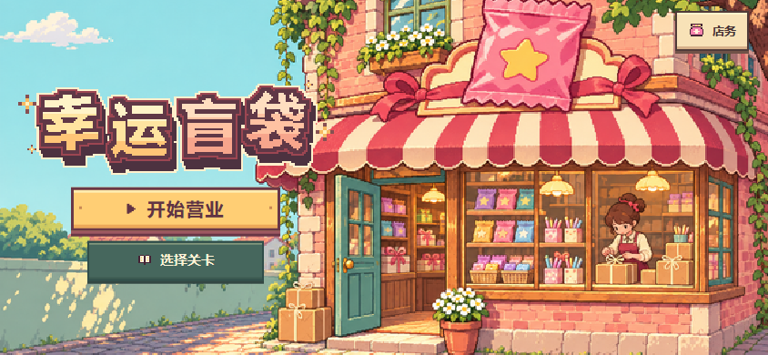

# 幸运盲袋

一款横屏像素打包游戏。看看顾客点了几勺、喜欢什么颜色，舀珠子倒进盘里，按每颗珠子对应的品类从整面货架取货，最后加赠、封箱寄出。

正式入口已使用像素店铺首页和横向街道选关。首页可开始营业或继续未完成的订单，点「选择关卡」沿街浏览，每章十关。点位小票显示满勺数和颜色偏好，接单后进入舀珠柜台。订单册、图鉴、随心接单、柜台陈列和设置收在「店务」里。第一关及新货上架的操作引导与正式进度一同保存。首页与街道素材随 `Game/assets/front/` 打包，可离线加载。

十章各有对应场景：小店开张、书桌文具街、周末邮局、花房、海边摊位、雨巷、灯串夜市、手作集市、居民街与百单庆典。每张场景按路面配置十个关卡点，仍可左右滑动和翻章。相邻章节会提前加载，换章时先准备好目标场景，再切换画面。

菜单与柜台使用同一首店内音乐，切换页面连续播放。暂停时音乐淡出，继续后淡入；音乐、音效和减少动态效果的设置在各页面共用。

**美术硬性要求：整款游戏统一像素风。** 首页、工作台、货架、货品、动效和结算使用同一套像素视觉语言。经营游戏参考仅用于交互与节奏，画风变更须由用户明确确认。详见[项目顶层规范](AGENTS.md)。

[十章场景总览](设计文档/接单台设计/十章场景总览.png) · [十章选关与新版订单试玩录屏（含游戏原声）](设计文档/接单台设计/试玩录屏_十章地图与新版订单.mp4)

接单小票用满勺数量和颜色印章呈现顾客需求；柜台配货单保留当前货品、配货数量和整单进度。可查看[新版接单画面](设计文档/接单台设计/新版接单.png)与[货架近景配货单](设计文档/接单台设计/新版配货单-近景.png)。

## 开始打包

- **电脑试玩**　下载仓库后，用浏览器打开 [Game/index.html](Game/index.html)。素材和音乐都随项目提供，可以离线玩。
- **iPhone 与 iPad**　在 Mac 上使用 Xcode 打开 [LuckyBags.xcodeproj](iOS/LuckyBags.xcodeproj)，选择 `LuckyBags` 和目标设备运行。工程支持 iOS 16 起的双向横屏。真机安装需要可用的开发签名。
- **运行规则测试**　在仓库根目录运行 `node --test tests/*.test.cjs`。

关卡册收录 100 笔按顺序解锁的订单，前 10 关点 1 勺，第 11–40 关点 2 勺，第 41–100 关点 3 勺。随心接单可选择 1–3 满勺和颜色偏好。每满勺随机舀出 20–28 颗珠子，每颗对应一件货，重复珠子会累加数量。接单时只确定勺数和偏好，实际舀取时随机抽取已上架品类，倒盘后显示对应货品。全店共 24 类、180 个款色组合，图鉴记录实际寄出过的货品。

舀起后，把勺子拖到盘子里或轻点倒出。勺子倾斜，珠子依次落盘、弹动，再归成小堆。舀完订单上的勺数后，盘中每颗珠子旁画着对应的货品，点它镜头直接推近到那一区，也可打开小票上的珠子对照表。货架分为发饰、书写、纸品和随身四区，还没到货的格子先码着封好的纸箱。点其中一区，镜头推近，直接点架上的实物取货，或把它拖进盒子。货品从货格移到盒内的实际位置，放稳后镜头再退回。按住货品不放可以连续取货，第一次遇到一类要拿四件以上时会有引导。没拿齐的珠子排在前面，拿齐的退到后面。最后一件放进盒里时，盒子轻轻一压并响起和弦，「核对装箱」随之跳动。点左上角的返回箭头可以换区。拿错的那件当场在盒里描出红框，小票标出拿错几件，点它就退回货架，也可以撤回。封箱前可从货架上选零至两件赠品。满意度和星币按配货的品类、偏好颜色和数量计算。整盒没有一件拿错或缺少才得三星，80% 以上二星，60% 以上一星；回信只列出不对的那几行。一章十关都拿到三星，额外奖励 200 星币。

## 小店怎样长大

开门时有发箍、笔、本子、发夹、贴纸、零钱包，每款都备六色。首次寄出指定的关卡订单，回执上会附一张到货单。下一关的第一勺带出一颗新货珠子，取用一次便完成新货位教学。重玩可以赚星币，首次到货只记一次。旧存档里已经寄出过的品类继续供货，已经接下的旧单按原图卡配完。舀起后暂未倒盘的结果也会保存，重新进入可接着倒出。

| 首次寄出的关卡 | 按顺序到货 |
| --- | --- |
| 1、2、4、7、8 | 钥匙扣、便签、书签、橡皮、水杯 |
| 10、13、16、20、23、29 | 自动铅笔、卡套、荧光笔、和纸胶带、长尾夹、收纳袋 |
| 34、38、42、49、58、69、81 | 发圈、抓夹、发带、发梳、折叠镜、卷笔刀、修正带 |

首页星币旁的「柜台陈列」打开实景样本册。开店自带原木桌、亚麻方格桌布和榉木柜。每次首次寄出下表中的关卡订单，回执的星币栏会附上一枚新样，点它能在自己的柜台试摆。每一页只预告下一款的到样关卡。玩家可以跳过某款，把星币留给喜欢的陈列。

| 首次寄出 | 到样 | 星币 |
| --- | --- | --- |
| 第 1 关 | 海盐条纹桌布 | 80 |
| 第 5 关 | 胡桃木桌面 | 340 |
| 第 12 关 | 青瓷漆柜 | 760 |
| 第 27 关 | 莓果织花桌布 | 1380 |
| 第 50 关 | 奶油漆木桌面 | 2300 |
| 第 90 关 | 樱桃木柜 | 3400 |

满分寄件收入为 100 星币，重玩和随心单都能攒钱。已买款式可免费换回，旧存档按当时的成交价记账。

[查看柜台陈列的实景试摆](设计文档/柜台陈列_实景试摆.png)

## 设计与声音

- [横屏适配与试玩记录 v0.4](设计文档/横屏适配与试玩_v0.4.md) · [一整单的游戏原声](设计文档/实际打包试玩_v0.4.m4a)
- [横屏工作台与货品实装手册 v0.3（Word）](设计文档/幸运盲袋_横屏工作台与货品实装_v0.3.docx)
- [百关订单与数量设计](设计文档/幸运盲袋_百关订单与打包设计_v0.2.docx)
- [iPad 尺寸游戏画面](设计文档/横屏工作台_iPad尺寸.png) · [水杯架](设计文档/分格水杯架_iPad尺寸.png) · [加赠长尾夹](设计文档/封箱前加赠长尾夹_iPad尺寸.png)
- [柜台音乐](设计文档/柜台音乐_v0.3.wav) · [带舀珠、撕袋、取货和封箱的混音试听](设计文档/横屏打包试听_v0.3.wav)

第一章十关免费试玩，随心接单也免费。接第十一关起弹出「解锁完整版」，一次购买开放第二到第十章，可在同一 Apple 账户的设备上恢复购买。

- **iOS 内购**　非消耗型商品，产品 ID `com.luckybags.pixelshop.fullgame`，由 [App.swift](iOS/LuckyBags/App.swift) 里的 StoreKit 2 处理购买、恢复与延迟批准。需要先在 App Store Connect 为该 App 建好同 ID 的 App 内购买项目并选定价格。
- **本地测试**　Xcode 运行 `LuckyBags` 方案时自动加载 [LuckyBags.storekit](iOS/LuckyBags.storekit)，可在模拟器里走完购买、取消与恢复。
- **网页版**　没有 App Store，点解锁直接在本机记一个测试标记，只供开发试玩。
