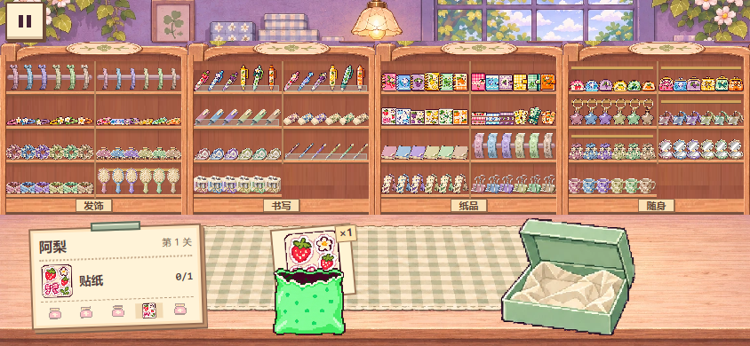

# 幸运盲袋

一款横屏像素打包游戏。看看顾客的小票，舀一勺、撕开盲袋，从一整面货架上挑好小物，最后选一两件礼物随包裹寄出。

**美术硬性要求：整款游戏统一像素风。** 首页、工作台、货架、货品、动效和结算使用同一套像素视觉语言。经营游戏参考仅用于交互与节奏，画风变更须由用户明确确认。详见[项目顶层规范](AGENTS.md)。

[放大货架取货的试玩动图](设计文档/大货架_点区放大取货.gif) · [店铺首页截图](设计文档/像素店铺_首页.png)

## 开始打包

- **电脑试玩**　下载仓库后，用浏览器打开 [Game/index.html](Game/index.html)。素材和音乐都随项目提供，可以离线玩。
- **iPhone 与 iPad**　在 Mac 上使用 Xcode 打开 [LuckyBags.xcodeproj](iOS/LuckyBags.xcodeproj)，选择 `LuckyBags` 和目标设备运行。工程支持 iOS 16 起的双向横屏。真机安装需要可用的开发签名。
- **运行规则测试**　在仓库根目录运行 `node --test tests/*.test.cjs`。

关卡册收录 100 笔固定订单，按顺序解锁。随心接单从店里已上架的品类中抽五种，每种一至三件。全店共 24 类、180 个款色组合，图鉴记录实际寄出过的货品。

货架分为发饰、书写、纸品和随身四区。点其中一区，镜头推近，直接点架上的实物取货，或把它拖进盒子。长按可连取，点左上角的返回箭头可以换区。拿错可以撤回，也可以点盒中那件退货。封箱前可从货架上选零至两件赠品。满意度和星币按正单的品类、颜色、指定款式和数量计算。

## 小店怎样长大

开门时有发箍、笔、本子、发夹、贴纸、零钱包，每款都备六色。首次寄出指定的关卡订单，回执上会附一张到货单。下一关的第一袋点名这批新货，玩家能马上到固定货位取用。重玩可以赚星币，首次到货只记一次。旧存档里已经寄出过的品类继续供货，已经接下的旧单按原图卡配完。

| 首次寄出的关卡 | 按顺序到货 |
| --- | --- |
| 1、2、4、7、8 | 钥匙扣、便签、书签、橡皮、水杯 |
| 10、13、16、20、23、29 | 自动铅笔、卡套、荧光笔、和纸胶带、长尾夹、收纳袋 |
| 34、38、42、49、58、69、81 | 发圈、抓夹、发带、发梳、折叠镜、卷笔刀、修正带 |

首页星币旁的「柜台陈列」打开实景样本册。开店自带原木桌、亚麻方格桌布和榉木柜。每次首次寄出下表中的关卡订单，回执的星币栏会附上一枚新样，点它能在自己的柜台试摆。每一页只预告下一款的到样关卡。玩家可以跳过某款，把星币留给喜欢的陈列。

| 首次寄出 | 到样 | 星币 |
| --- | --- | --- |
| 第 1 关 | 海盐条纹桌布 | 80 |
| 第 5 关 | 胡桃木桌面 | 340 |
| 第 12 关 | 青瓷漆柜 | 760 |
| 第 27 关 | 莓果织花桌布 | 1380 |
| 第 50 关 | 奶油漆木桌面 | 2300 |
| 第 90 关 | 樱桃木柜 | 3400 |

满分寄件收入为 100 星币，重玩和随心单都能攒钱。已买款式可免费换回，旧存档按当时的成交价记账。

[查看柜台陈列的实景试摆](设计文档/柜台陈列_实景试摆.png)

## 设计与声音

- [横屏适配与试玩记录 v0.4](设计文档/横屏适配与试玩_v0.4.md) · [一整单的游戏原声](设计文档/实际打包试玩_v0.4.m4a)
- [横屏工作台与货品实装手册 v0.3（Word）](设计文档/幸运盲袋_横屏工作台与货品实装_v0.3.docx)
- [百关订单与数量设计](设计文档/幸运盲袋_百关订单与打包设计_v0.2.docx)
- [iPad 尺寸游戏画面](设计文档/横屏工作台_iPad尺寸.png) · [水杯架](设计文档/分格水杯架_iPad尺寸.png) · [加赠长尾夹](设计文档/封箱前加赠长尾夹_iPad尺寸.png)
- [柜台音乐](设计文档/柜台音乐_v0.3.wav) · [带舀珠、撕袋、取货和封箱的混音试听](设计文档/横屏打包试听_v0.3.wav)

当前可玩版开放完整百关、离线存档和随心接单。正式版的收费方向是前十单免费试玩、一次性 ¥9.9 解锁。StoreKit 购买、恢复购买、真机验证与 App Store 提交属于后续发行工作。
