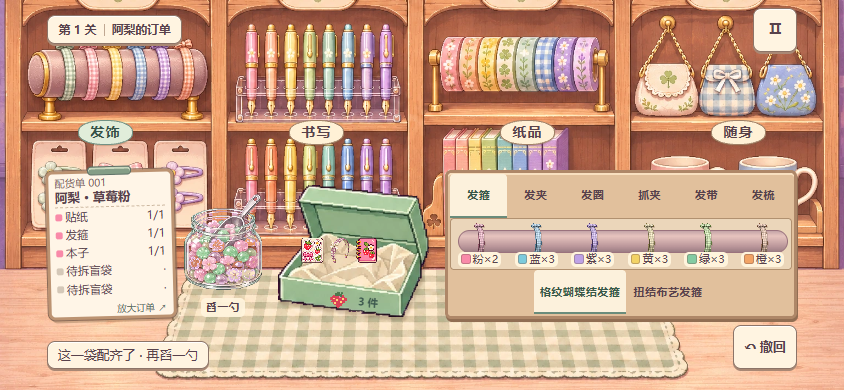

# 幸运盲袋

一款横屏像素打包游戏。看看顾客的小票，舀一勺、撕开盲袋，从四面货架上挑好颜色和数量，最后选一两件小礼物随包裹寄出。

## 开始打包

- **电脑试玩**　下载仓库后，用浏览器打开 [Game/index.html](Game/index.html)。素材和音乐都随项目提供，可以离线玩。
- **iPhone 与 iPad**　在 Mac 上使用 Xcode 打开 [LuckyBags.xcodeproj](iOS/LuckyBags.xcodeproj)，选择 `LuckyBags` 和目标设备运行。工程支持 iOS 16 起的双向横屏。真机安装需要可用的开发签名。
- **运行规则测试**　在仓库根目录运行 `node --test tests/*.test.cjs`。

关卡册收录 100 笔固定订单，按顺序解锁，前 10 关可以体验全部六色。随心接单会从 24 类货品中抽五种，每种一至三件。图鉴共 180 款，按品类、款式和颜色分别收藏。

点货架切换陈列区，再点右侧色位取货，或直接把小物拖进盒子。拿错可以撤回，也可以点盒中那件退货。长按同一色位可以连续取货。有余货时，同色商品自动补位。封箱前可自由选零至两件赠品。满意度和星币按正单的品类、颜色、指定款式和数量计算。

## 设计与声音

- [横屏适配与试玩记录 v0.4](设计文档/横屏适配与试玩_v0.4.md) · [一整单的游戏原声](设计文档/实际打包试玩_v0.4.m4a)
- [横屏工作台与货品实装手册 v0.3（Word）](设计文档/幸运盲袋_横屏工作台与货品实装_v0.3.docx)
- [百关订单与数量设计](设计文档/幸运盲袋_百关订单与打包设计_v0.2.docx)
- [iPad 尺寸游戏画面](设计文档/横屏工作台_iPad尺寸.png) · [水杯架](设计文档/分格水杯架_iPad尺寸.png) · [加赠长尾夹](设计文档/封箱前加赠长尾夹_iPad尺寸.png)
- [柜台音乐](设计文档/柜台音乐_v0.3.wav) · [带舀珠、撕袋、取货和封箱的混音试听](设计文档/横屏打包试听_v0.3.wav)

当前可玩版开放完整百关、离线存档和随心接单。正式版的收费方向是前十单免费试玩、一次性 ¥9.9 解锁。StoreKit 购买、恢复购买、真机验证与 App Store 提交属于后续发行工作。
